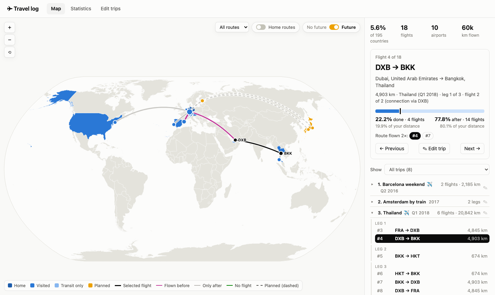
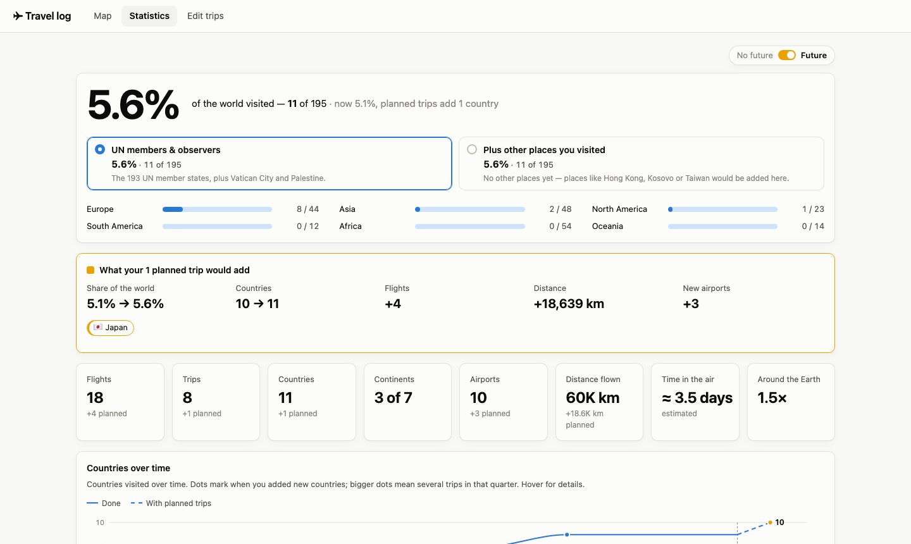
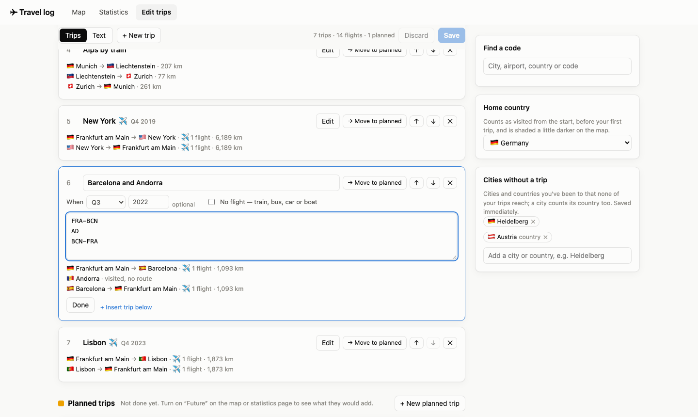

# Travel log

A small web app that runs on your own computer and turns a list of your trips into a world map and travel
statistics: which countries you've been to, which airports you used and how often, how your country count grew
over time, and what a planned trip would add. You enter trips as simple lists of airport codes (`FRA-DXB-BKK`);
no dates, accounts or internet connection are needed.

**[Try the demo](https://kjell5317.github.io/travel-log/)** — it runs in your browser with example data.



## Features

- **World map** of visited countries, flight routes (great-circle arcs), trips you made without flying, and
  airports sized by how often you used them. Zoom, pan, filter by trip, click anything for details.
- **Your flight history in order**: select a flight to see its number ("flight 4 of 18") and how much of your
  flying — by count and by distance — was done up to then.
- **Statistics**: share of the world's countries visited, countries per continent, countries over time,
  domestic vs. international flights, short- vs. long-haul, records (longest flight, northernmost place …),
  airports, time in the air.
- **Planned trips**: add trips you haven't made yet and switch on *Future* to see what they would add.
- **Everything else you need for an honest count**: trips by train, car or boat; countries without an airport;
  cities and countries you visited outside any trip; your home country.
- **Private by design**: your data is a JSON file on your disk. The app makes no network requests while running.

## Getting started

You need [Node.js](https://nodejs.org/) 20.19+ or 22.12+ (which includes npm).

```sh
git clone <this repository>
cd travel
npm install
npm start          # opens http://localhost:5317
```

The app starts empty. To look around first, click **Load example** on the map page (or run `npm run example`
before `npm start`). To start over with your own trips, delete `data/travel.json`.

## How it works

### Flights, legs and trips

| Term       | Meaning                                                                 | Example                       |
| ---------- | ----------------------------------------------------------------------- | ----------------------------- |
| **Flight** | One takeoff and landing between two airports                            | `FRA → DXB`                   |
| **Leg**    | One or more flights without leaving the airport (a connection)          | `FRA-DXB-BKK` = 2 flights     |
| **Trip**   | Legs that belong together, e.g. the way there and the way back          | `FRA-DXB-BKK` + `BKK-DXB-FRA` |

Places are written as 3-letter [IATA codes](https://en.wikipedia.org/wiki/IATA_airport_code). The editor has a
search to look up codes by city or airport name.

### Order and dates

Trips are listed oldest first, and that order is all the app needs: flight numbers and the "done / after"
figures of a selected flight come from it. A date is optional: a year, or a quarter and a year. Dated trips put
the *Countries over time* chart on a real time axis; undated trips are placed between their dated neighbours.

### Kinds of trips

- **Flights** — the default. Every connection is a flight, drawn as a magenta arc.
- **No flight** — trips by train, bus, car or boat. Use the nearest airport codes to mark the places. They count
  for countries, not for flights, airports or distance flown, and are drawn as green lines. Their way out of and
  back into your home country isn't drawn by default (it clutters the map); switch on *Home routes* to see it.
- **Planned** — trips you haven't made yet. They're ignored until you turn on *Future* on the map or statistics
  page; then countries and airports you'd visit for the first time turn amber, their routes are dashed, and the
  statistics show what they would add.

### Places without an airport

- **Country codes**: write a 2-letter [ISO country code](https://en.wikipedia.org/wiki/ISO_3166-1_alpha-2) instead
  of an airport, e.g. `MUC-LI-ZRH`, or alone on a line (`AD`) to say "I was there on this trip". In no-flight
  trips the place is marked in the middle of the country; in flight trips, connections to a country are never
  counted as flights and aren't drawn.
- **Cities without a trip**: in the editor sidebar, add any city (about 70,000 to choose from, with or without an
  airport) or country you've been to outside your trips. A city counts its country as visited.
- **Home country**: counts as visited from the start, before your first trip, and is shaded a little darker.

### What counts as visited

A country counts as **visited** when a leg starts or ends there, when it's your home country, or when you added it
(or one of its cities) by hand. Places you only passed through — changing planes, or the middle of a no-flight
leg — make a country **transit only**.

The share of the world is measured against the 195 UN member and observer states. The statistics page can also
add the other places you visited (e.g. Hong Kong, Kosovo) to both the count and the total.

## Using the app

**Map.** The routes menu shows *All routes*, only *Flights*, only trips with *No flights*, or *No routes* (just the
places you've been to). *Show* filters the map to one trip and zooms to it. Click a flight, airport or country for
details; use ← / → to step through your flights in order; ✎ opens a trip in the editor.

**Statistics.** Pick what counts as a country at the top, then scroll through the chart, flight mix, records,
countries and airports. With *Future* on, a card shows what your planned trips would add.



**Edit trips.** Each trip is a card: a name, an optional date, *No flight* if you didn't fly, and one leg per line.
The preview under the text shows the cities and distances, and problems are pointed out as you type. *Text* mode
shows all trips as one text (handy for pasting a whole history). Save with the button or ⌘S / Ctrl+S.



### Text format

In *Text* mode, each trip starts with `# Name`, followed by optional markers, then one leg per line. Codes can be
separated by `-`, `>`, `→`, commas or spaces.

```text
# Thailand (Q1 2018)
FRA-DXB-BKK
BKK-HKT
HKT-BKK-DXB-FRA

# Alps by train (no flight)
MUC-LI
LI-ZRH

# Barcelona and Andorra (2022)
FRA-BCN
AD
BCN-FRA

# Japan (Q2 2027) (planned)
FRA-HEL-NRT
KIX-HEL-FRA
```

## Your data

Your travel log lives in `data/travel.json`. The app writes it whenever you save (keeping the previous version as
`data/travel.backup.json`), and the whole `data/` folder except the example is ignored by git, so your trips never
end up in the repository. You can also edit the file by hand while the app isn't open.
[`data/travel.example.json`](data/travel.example.json) shows every field:

| Field | Meaning |
| --- | --- |
| `trips` | Oldest first. Each has an `id`, a `name`, `legs` (lists of codes), and optionally `date` (`"2019"` or `"2019-Q3"`), `noFlight: true` and `planned: true`. |
| `extraCountries` | Countries visited outside your trips (2-letter codes). |
| `extraCities` | Cities visited outside your trips: `name`, `country`, `lat`, `lon`. |
| `customAirports` | Codes the bundled database doesn't know, e.g. `"XYZ": { "name": "…", "city": "…", "country": "DE", "lat": 50.1, "lon": 8.6 }`. |
| `settings` | `countryBasis` (`"un+observers"` or `"un+observers+visited"`) and `homeCountry` (2-letter code). |

## Reference data

The app ships with prepared data in `src/data/`, built by `npm run update-data` from these sources:

| Source | Used for | License |
| --- | --- | --- |
| [OurAirports](https://ourairports.com/data/) | ~9,000 airports with IATA codes: name, city, country, position | Public domain |
| [OpenFlights](https://openflights.org/data) | Closed airports whose codes OurAirports no longer lists (e.g. TXL, SXF) | [ODbL 1.0](https://opendatacommons.org/licenses/odbl/1-0/) |
| [world-countries](https://github.com/mledoze/countries) | Country names, UN membership, flags, centres | [ODbL 1.0](https://opendatacommons.org/licenses/odbl/1-0/) |
| [GeoNames](https://www.geonames.org/) | ~70,000 cities (5,000+ inhabitants) for the city search, and the city an airport serves when it's listed under a suburb (Kraków instead of Balice) | [CC BY 4.0](https://creativecommons.org/licenses/by/4.0/) |
| [Natural Earth](https://www.naturalearthdata.com/) via [world-atlas](https://github.com/topojson/world-atlas) | Country shapes for the map | Public domain |

`src/data/airports.json` and `src/data/countries.json` are derived from ODbL databases and are therefore made
available under the ODbL 1.0; `src/data/cities.json` is derived from GeoNames under CC BY 4.0. A few codes that
none of the sources list (such as the rail station code ZPD) are added in `scripts/build-data.mjs` (`EXTRA_CODES`).

## Development

| Command               | What it does                                                     |
| --------------------- | ---------------------------------------------------------------- |
| `npm start`           | Starts the app and opens it in the browser                       |
| `npm run example`     | Copies the example data to `data/travel.json` (never overwrites) |
| `npm test`            | Runs the unit tests (parsing, statistics, search, map rules)     |
| `npm run typecheck`   | Type-checks the project                                          |
| `npm run build`       | Production build; `npm run preview` serves it, including saving  |
| `npm run build:demo`  | Static demo build for GitHub Pages (see below)                   |
| `npm run update-data` | Downloads the sources above and rebuilds `src/data/`             |

The app is React + TypeScript on [Vite](https://vite.dev/), with [d3-geo](https://github.com/d3/d3-geo) for the
map. There is no separate backend: a small Vite middleware ([`server/dataApi.ts`](server/dataApi.ts)) reads and
writes `data/travel.json` at `/api/data`.

```text
src/
  lib/         data model, parsing, statistics, reference data lookups (with tests)
  components/  map, charts
  views/       the map, statistics and editor pages
  data/        generated reference data (see above)
scripts/       data build and helper scripts
server/        the local data API
data/          your travel log (ignored by git) and the example
```

The data API has no authentication: it only listens on `localhost`, so don't start the app with `--host` on a
network you don't trust.

### The demo on GitHub Pages

GitHub Pages can only serve files, so the demo is a separate build (`npm run build:demo`, switched on by
[`.env.demo`](.env.demo)): it starts with the example data and saves changes in the visitor's browser
(localStorage) instead of a file, with a banner that says so and a button to reset to the example.

The workflow [`.github/workflows/pages.yml`](.github/workflows/pages.yml) runs the tests, builds the demo for the
repository's Pages address and deploys it on every push to `main` (or by hand from the *Actions* tab). To use it
in your own copy, set *Settings → Pages → Build and deployment → Source* to **GitHub Actions** once.
